# FitGoal · Arquitectura de la solución (borrador del capítulo para ES2)

Este documento reúne el diseño técnico de FitGoal que exige la Evaluación Sumativa 2: procesos de negocio en BPMN, casos de uso y componentes en UML, modelo y diccionario de datos, topología de comunicaciones, infraestructura y arquitectura integrada. Se redactó tomando como especificación el informe de formulación del 01-10-2026 (`FitGoal_Formulacion_Proyecto_Corregida.docx`) y se genera con código, de modo que los diagramas, el esquema SQL y el diccionario sean coherentes entre sí.

**Estado de implementación.** Estos diagramas describen el MVP y coinciden con el código del repositorio. El modelo de datos está implementado y verificado como migración SQL (20 tablas, con sus reglas de integridad probadas en PostgreSQL 18), la API Node.js/Express y la app Flutter están construidas según este diseño y tienen pruebas automáticas. Las pautas de alimentación usan contenido de demostración que la nutricionista del proyecto debe revisar y aprobar antes del piloto. Quedan fuera del alcance actual el despliegue en Render y las pruebas de carga.

**Cómo regenerar.** Desde `docs/diagramas`: `node build.mjs` (diagramas) y `node generate.mjs` (SQL y documentos). `node schema/validate.mjs` aplica el esquema en PostgreSQL y prueba sus reglas.

## 1. Contexto del sistema

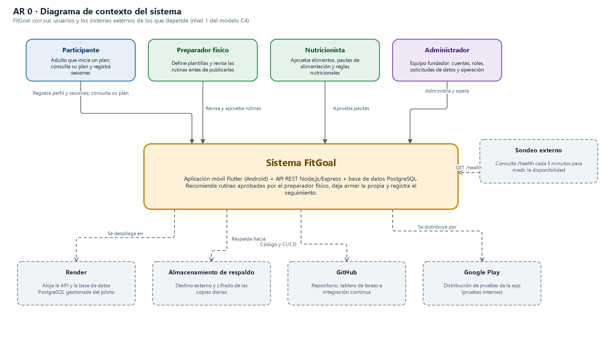

FitGoal es usado por cuatro roles: el participante, el preparador físico, la nutricionista (por incorporar) y el administrador, que es el equipo fundador a cargo de la operación. El sistema depende de Render (API y base de datos del piloto), de un almacenamiento externo cifrado para los respaldos, de GitHub (código, tablero e integración continua), de Google Play (pruebas internas) y de un sondeo externo que mide la disponibilidad.

## 2. Procesos de negocio (BPMN)

Se modelaron cinco procesos principales con BPMN 2.0. Los tres primeros forman el ciclo de valor de FitGoal para la persona: incorporarla y recomendarle rutinas aprobadas (P1), dejarla empezar de inmediato una rutina recomendada o propia (P2) y acompañar su seguimiento (P3). El cuarto (P4) responde a una obligación legal y ética propia de trabajar con datos asociados a salud: atender los derechos del titular sobre sus datos. El quinto (P5) es el control de calidad del servicio: el profesional aprueba una sola vez, con versión y trazabilidad, todo lo que reciben las personas. Cada proceso tiene un diagrama de nivel 1, con carriles por actor, y otro con sus subprocesos expandidos. Las tareas azules son automáticas y representan la optimización del proceso: lo que el sistema resuelve sin intervención humana.

Los procesos se conectan así: P5 prepara el catálogo aprobado que usan P1 y P2; P1 termina con la lista de rutinas para elegir; P2 inicia la rutina vigente que alimenta P3; un cambio de perfil en P3 vuelve a P1 para ver nuevas recomendaciones; y P4 puede iniciarse en cualquier momento del ciclo. No existe revisión caso a caso: la persona recibe al instante lo que ya está aprobado.

### P1 · Registro, perfil y recomendación de rutinas aprobadas

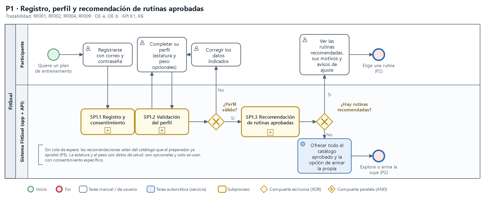

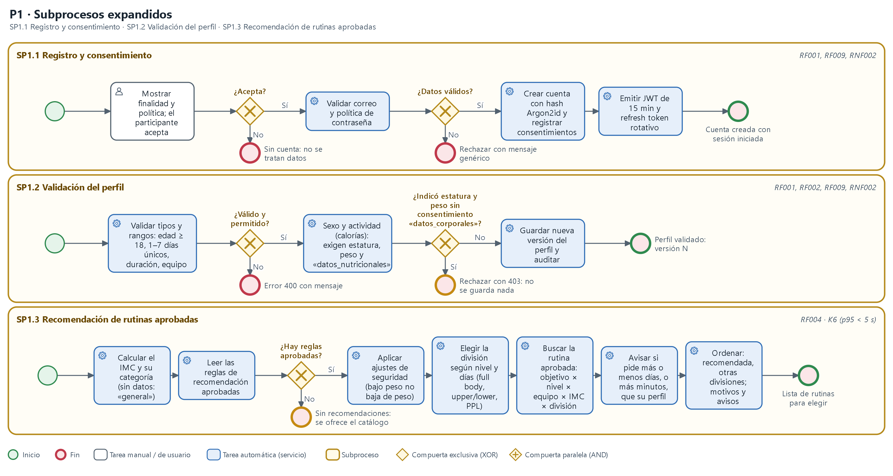

| Elemento | Descripción |
| --- | --- |
| Objetivo | Incorporar al participante con consentimiento informado y convertir su perfil en una lista de rutinas aprobadas que le calzan, sin esperas. |
| Disparador | Una persona adulta decide iniciar un plan de entrenamiento y abre la app. |
| Actores | Participante y sistema FitGoal. |
| Resultado | Lista de rutinas con sus motivos, con las recomendadas primero; o el catálogo completo si no hay una recomendación para su perfil. |
| Requerimientos | RF001, RF002, RF004, RF009, RNF001, RNF002, RNF004 |
| Indicadores | K1 (registro sin ayuda en menos de 5 minutos) y K6 (p95 menor a 5 segundos). |

**Flujo.**

1. El participante se registra con correo y contraseña y acepta los consentimientos (SP1.1).
2. Completa objetivo, nivel, días, duración y equipo y, si quiere, su estatura y peso. El sistema valida el perfil (SP1.2) y, si es inválido, indica el campo para corregirlo. La estatura y el peso son datos de salud: son opcionales y solo se guardan con su consentimiento específico.
3. Si informó su estatura y peso, el sistema calcula su IMC (peso / estatura²) y su categoría, con los cortes de la OMS o, desde los 65 años, del Minsal. Aplica las reglas de seguridad aprobadas (con bajo peso no se recomienda bajar de peso; con obesidad, no subir de peso), elige la división de la semana según su nivel y sus días disponibles (full body, upper/lower o push/pull/legs), busca en la matriz la rutina recomendada para su objetivo, nivel, equipo, categoría y división, y avisa si pide más o menos días, o más minutos, que su perfil (SP1.3). Sin estatura y peso recomienda la rutina general de bajo impacto.
4. La app muestra la rutina recomendada con sus motivos y, a continuación, las otras divisiones para el mismo perfil como alternativas. Si no hay ninguna para su perfil, ofrece todo el catálogo aprobado y la opción de armar la propia. El flujo continúa en P2.

**Subprocesos.**

| Subproceso | Qué hace | Trazabilidad |
| --- | --- | --- |
| SP1.1 Registro y consentimiento | Mostrar finalidad y política, validar correo y contraseña, crear la cuenta con Argon2id, registrar consentimientos con su versión y emitir JWT y refresh token. | RF001, RF009, RNF002 |
| SP1.2 Validación del perfil | Validar tipos y rangos (edad adulta, 1 a 7 días únicos, duración permitida), exigir juntos la estatura y el peso, en rangos humanos y con el consentimiento «datos_corporales», exigir para el sexo y la actividad la estatura, el peso y el consentimiento «datos_nutricionales», y guardar una versión nueva del perfil. | RF001, RF002, RF009, RNF002 |
| SP1.3 Recomendación de rutinas aprobadas | Calcular el IMC y su categoría (la categoría «general» si no informó estatura y peso), leer las reglas aprobadas y aplicar sus ajustes de seguridad, elegir la división con la primera condición de nivel y días que se cumpla, buscar la rutina aprobada de la matriz objetivo × nivel × equipo × categoría × división, avisar de ajustes de días y minutos y ordenar: la recomendada, las otras divisiones como alternativas y luego el resto. | RF004 |

**Optimización.** No hay cola de espera: la recomendación sale del catálogo que el preparador ya aprobó (P5) y se calcula en menos de 5 segundos. Cambiar el perfil no modifica la rutina vigente: solo actualiza las recomendaciones.

### P2 · Inicio de la rutina: recomendada o propia

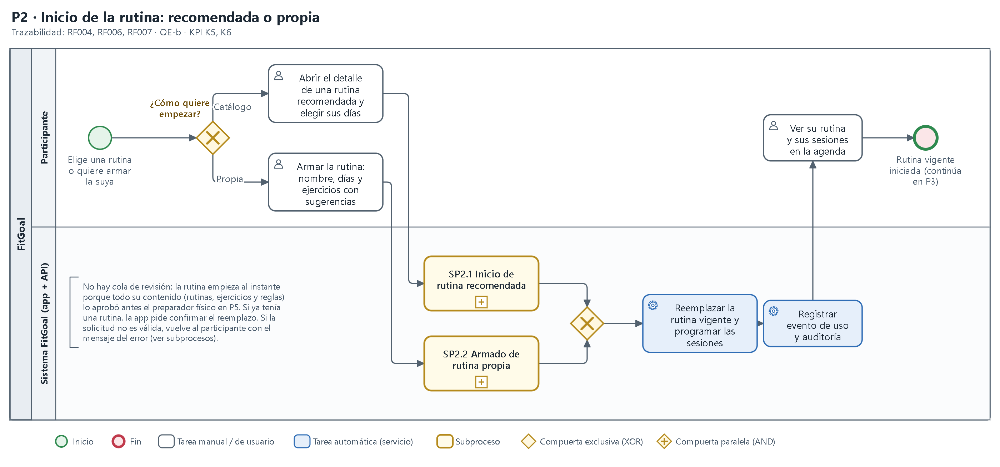

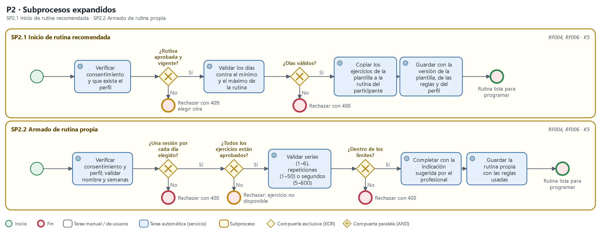

| Elemento | Descripción |
| --- | --- |
| Objetivo | Permitir que la persona empiece de inmediato una rutina aprobada por el preparador, o arme la propia con ejercicios aprobados, sin revisión caso a caso. |
| Disparador | La persona elige una rutina de la lista o decide armar la suya. |
| Actores | Participante y sistema FitGoal. |
| Resultado | Rutina vigente con sus ejercicios y sus sesiones programadas; la rutina anterior, si la había, queda reemplazada en el historial. |
| Requerimientos | RF004, RF006, RF007, RNF004 |
| Indicadores | K5 (100% de las rutinas vigentes compuestas por contenido aprobado) y K6 (p95 menor a 5 segundos). |

**Flujo.**

1. La persona elige cómo empezar: una rutina recomendada del catálogo o una propia.
2. Rutina recomendada: abre el detalle, revisa sesiones y ejercicios con su indicación y elige entre el mínimo y el máximo de días que contempla la rutina (SP2.1).
3. Rutina propia: le pone un nombre, elige sus días y agrega ejercicios de la biblioteca, con sugerencias según su objetivo; ajusta series, repeticiones o segundos dentro de límites seguros (SP2.2).
4. Si ya tenía una rutina, la app pide confirmar el reemplazo. El sistema reemplaza la vigente, quita las sesiones futuras sin hacer, programa las sesiones desde el día siguiente y registra el evento de uso y la auditoría.
5. La persona ve su rutina y su agenda; el seguimiento continúa en P3.

**Subprocesos.**

| Subproceso | Qué hace | Trazabilidad |
| --- | --- | --- |
| SP2.1 Inicio de rutina recomendada | Verificar consentimiento y perfil, que la rutina siga aprobada y vigente y que los días elegidos estén en su rango; copiar los ejercicios de la plantilla a la rutina del participante y guardarla con la versión de la plantilla, de las reglas y del perfil. | RF004, RF006 |
| SP2.2 Armado de rutina propia | Verificar consentimiento, perfil, nombre y semanas; exigir una sesión por día con ejercicios aprobados y sin repetir; validar series (1 a 6), repeticiones (1 a 50) o segundos (5 a 600); completar con la indicación sugerida por el profesional si no ajustó; guardar la rutina propia. | RF004, RF006 |

**Optimización.** La rutina empieza al instante porque todo lo que contiene ya fue aprobado en P5. La base de datos impide iniciar una plantilla o usar un ejercicio que no esté aprobado y congela la rutina iniciada. No hay trabajo manual por persona, lo que permite escalar el servicio.

### P3 · Seguimiento de sesiones y progreso

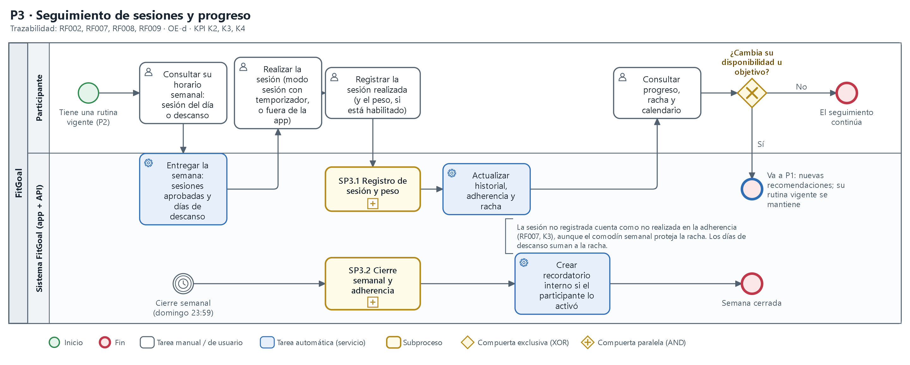

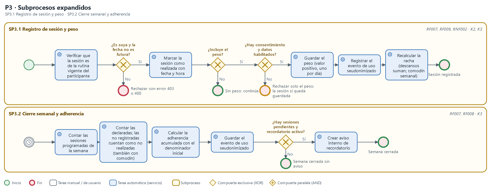

| Elemento | Descripción |
| --- | --- |
| Objetivo | Permitir que el participante vea cada día qué le toca (la sesión o el descanso), registre las sesiones realizadas y observe su continuidad con la adherencia, la racha y el calendario, calculados de forma automática. |
| Disparador | El participante tiene una rutina vigente (fin de P2). |
| Actores | Participante y sistema FitGoal. |
| Resultado | Sesiones registradas, historial actualizado, adherencia y racha calculadas; un cambio de perfil vuelve a P1 para ver nuevas recomendaciones. |
| Requerimientos | RF002, RF007, RF008, RF009 |
| Indicadores | K2 (retención en la semana 4), K3 (adherencia declarada mayor o igual a 75%) y K4 (utilidad percibida). |

**Flujo.**

1. El participante consulta su horario semanal (lunes a domingo); el sistema entrega la sesión de cada día con sus ejercicios aprobados, o el día de descanso con movilidad opcional del catálogo aprobado.
2. Realiza la sesión en el modo sesión de la app (marca sus series y usa el temporizador de descanso) o fuera de ella, y la registra como realizada, con su peso solo si está habilitado y hay consentimiento (SP3.1).
3. El sistema actualiza el historial, la adherencia y la racha (las sesiones registradas y los días de descanso suman; el comodín semanal cubre una sesión sin registro por semana); el participante consulta su progreso y su calendario.
4. Cada domingo a las 23:59 el sistema cierra la semana (SP3.2): las sesiones no registradas cuentan como no realizadas y, si el participante lo activó, crea un recordatorio interno.
5. Si el participante cambia su disponibilidad u objetivo, el flujo continúa en P1 con nuevas recomendaciones, y su rutina vigente se mantiene hasta que inicie otra.

**Subprocesos.**

| Subproceso | Qué hace | Trazabilidad |
| --- | --- | --- |
| SP3.1 Registro de sesión y peso | Verificar que la sesión es de la rutina vigente del participante y que su fecha no es futura, marcarla como realizada, verificar consentimiento y habilitación antes de guardar el peso, registrar el evento seudonimizado y recalcular la racha. | RF007, RF009, RNF002 |
| SP3.2 Cierre semanal y adherencia | Contar sesiones programadas y declaradas, tratar las no registradas como no realizadas (aunque el comodín semanal proteja la racha), calcular la adherencia acumulada con el denominador inicial, guardar el evento y crear el recordatorio si corresponde. El comodín de la racha se renueva cada lunes. | RF007, RF008 |

**Optimización.** Las sesiones se programan automáticamente al iniciar la rutina; la adherencia y la racha se calculan sin intervención y no se guardan (se deducen de las sesiones y de los días de la rutina). La racha cuenta los descansos para no premiar entrenar sin descanso. El peso es opcional y se bloquea sin consentimiento, de modo que el seguimiento no exige datos que el participante no haya autorizado.

### P4 · Atención de derechos sobre datos personales

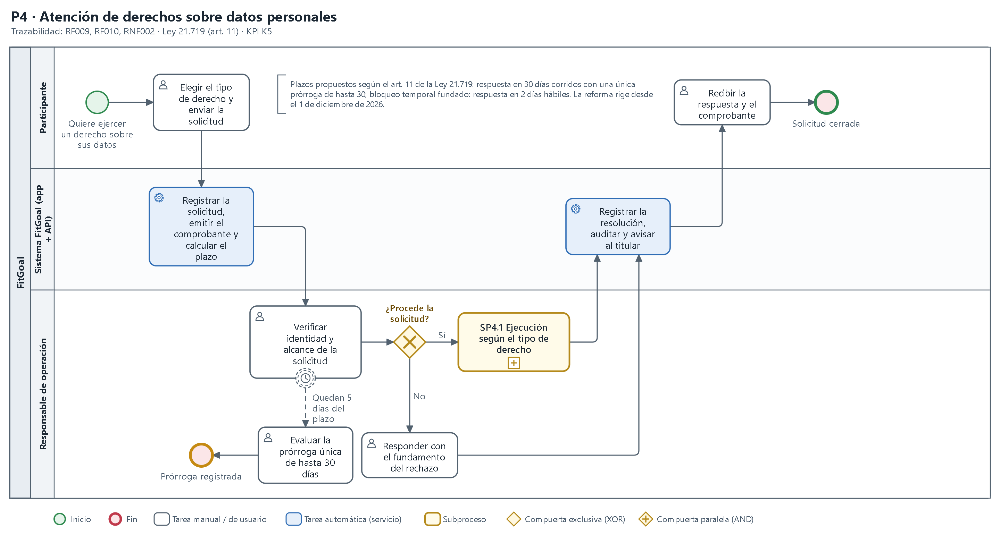

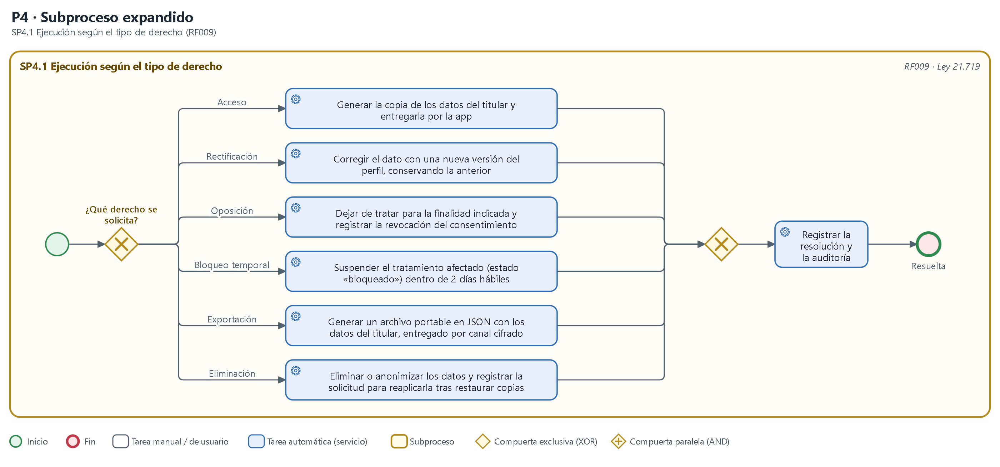

| Elemento | Descripción |
| --- | --- |
| Objetivo | Responder en plazo y con trazabilidad las solicitudes del titular sobre sus datos, tratándose de datos asociados a salud. |
| Disparador | El participante quiere ejercer un derecho sobre sus datos. |
| Actores | Participante, sistema FitGoal y responsable de operación (administrador). |
| Resultado | Solicitud resuelta con comprobante, registro de la resolución y auditoría. |
| Requerimientos | RF009, RF010, RNF002 |
| Indicadores | Se propone medir el porcentaje de solicitudes respondidas dentro del plazo (se formaliza en la sección de KPI y SLA). |

**Flujo.**

1. El participante elige el tipo de derecho (acceso, rectificación, oposición, bloqueo, exportación o eliminación) y envía la solicitud.
2. El sistema la registra, emite el comprobante y calcula el plazo: 30 días corridos, o 2 días hábiles para el bloqueo.
3. El responsable de operación verifica la identidad y el alcance. Si quedan 5 días del plazo, evalúa la prórroga única de hasta 30 días.
4. Si procede, ejecuta el derecho según su tipo (SP4.1); si no, responde con el fundamento del rechazo.
5. El sistema registra la resolución, audita y avisa al titular, que recibe la respuesta y el comprobante.

**Subprocesos.**

| Subproceso | Qué hace | Trazabilidad |
| --- | --- | --- |
| SP4.1 Ejecución según el tipo de derecho | Acceso: copia de los datos. Rectificación: nueva versión del perfil conservando la anterior. Oposición: dejar de tratar para la finalidad opcional y registrar la revocación, con borrado de la estatura y el peso. Bloqueo: suspender el tratamiento afectado dentro de 2 días hábiles. Exportación: archivo portable en JSON. Eliminación: eliminar o anonimizar y registrar la solicitud para reaplicarla tras restaurar copias. | RF009 |

**Optimización.** El comprobante y el plazo se calculan automáticamente, el sistema alerta antes del vencimiento y la ejecución queda auditada. Las eliminaciones se registran para reaplicarse si se restaura una copia de respaldo.

### P5 · Gobierno del catálogo: aprobación profesional

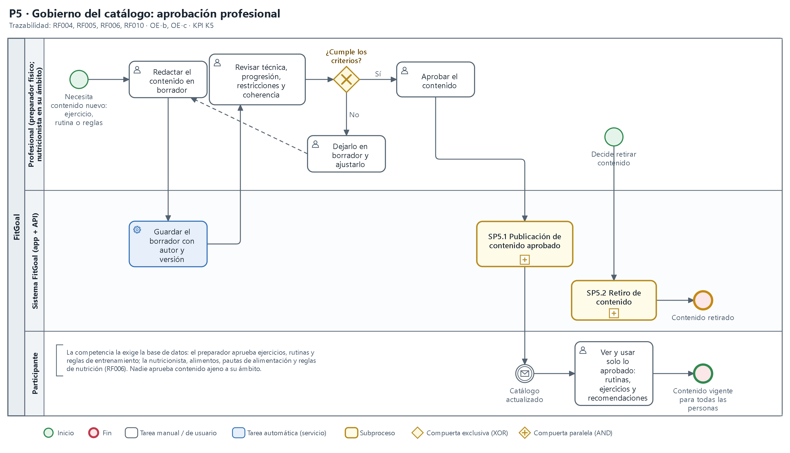

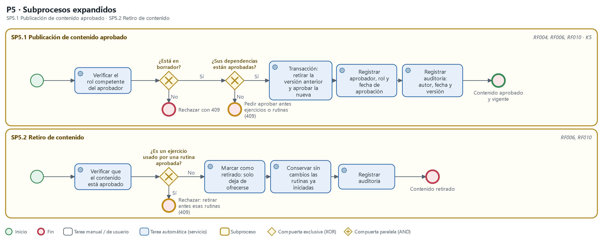

| Elemento | Descripción |
| --- | --- |
| Objetivo | Garantizar que todo lo que reciben las personas (ejercicios, rutinas y reglas de recomendación) lo haya aprobado, con versión y trazabilidad, un profesional competente. |
| Disparador | El preparador físico necesita contenido nuevo, ajustar uno existente o retirar uno que ya no corresponde. |
| Actores | Preparador físico (nutricionista en su ámbito), sistema FitGoal y participante, que consume el contenido. |
| Resultado | Contenido aprobado y vigente para todas las personas, con auditoría; o contenido retirado sin afectar las rutinas ya iniciadas. |
| Requerimientos | RF004, RF005, RF006, RF010 |
| Indicadores | K5 (100% de las rutinas vigentes compuestas por contenido aprobado) y K9 (minutos de intervención profesional por persona atendida). |

**Flujo.**

1. El profesional redacta el contenido en borrador (ejercicio, rutina o reglas); el sistema lo guarda con autor y versión.
2. Revisa técnica, progresión, restricciones y coherencia con el resto del catálogo. Si no cumple, lo ajusta y sigue en borrador.
3. Si cumple, lo aprueba. La publicación (SP5.1) verifica el rol competente, que sea un borrador y que sus dependencias estén aprobadas (los ejercicios de una rutina; las rutinas que nombran las reglas), retira la versión anterior y registra aprobador, fecha y auditoría en una sola transacción.
4. Desde ese momento todas las personas ven y pueden usar el contenido, y las recomendaciones lo incorporan.
5. Si el contenido deja de corresponder, el profesional lo retira (SP5.2): deja de ofrecerse y las rutinas ya iniciadas se conservan sin cambios.

**Subprocesos.**

| Subproceso | Qué hace | Trazabilidad |
| --- | --- | --- |
| SP5.1 Publicación de contenido aprobado | Verificar el rol competente y que sea un borrador; verificar que sus dependencias estén aprobadas; en una transacción retirar la versión aprobada anterior y aprobar la nueva con aprobador, rol y fecha; registrar la auditoría. | RF004, RF006, RF010 |
| SP5.2 Retiro de contenido | Verificar que el contenido está aprobado; rechazar el retiro de un ejercicio que use una rutina aprobada; marcar como retirado, conservar sin cambios las rutinas ya iniciadas y registrar la auditoría. | RF006, RF010 |

**Optimización.** El profesional trabaja una sola vez por contenido y no por cada persona: su criterio llega a todas sin cola de espera. La base de datos exige la competencia del aprobador, impide editar una versión aprobada y garantiza que una rutina solo use ejercicios aprobados.

## 3. Casos de uso (UML)

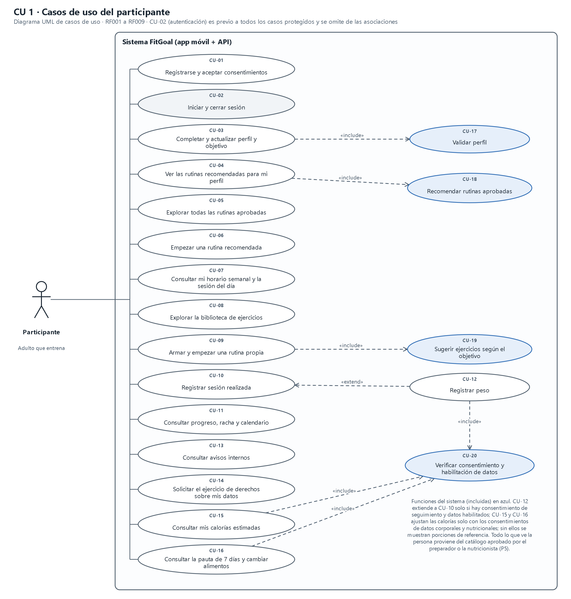

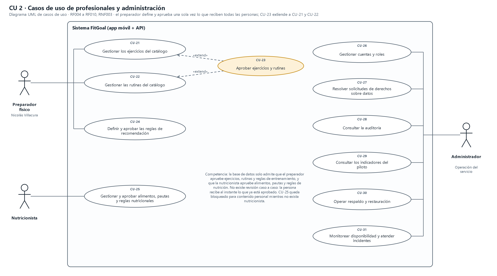

Los 31 casos de uso cubren los diez requerimientos funcionales. CU-02 (autenticación) es previo a todos los casos protegidos. CU-17 a CU-20 son funciones del sistema incluidas por otros casos; CU-12 extiende a CU-10 y CU-23 extiende a CU-21 y CU-22. Cada caso se relaciona con el problema del informe: personas que no saben estructurar un plan coherente (CU-03 a CU-09, con rutinas recomendadas y ayuda para armar la propia), la necesidad de validación profesional sin frenar el uso (CU-21 a CU-24: el profesional aprueba el catálogo una sola vez), el seguimiento que sostiene la continuidad (CU-10 a CU-13) y el cuidado de datos de salud (CU-12, CU-14, CU-20, CU-27).

### Especificación de los casos de uso

| Caso de uso | Actor | Requerimientos | Precondición | Flujo principal | Flujos alternativos | Postcondición |
| --- | --- | --- | --- | --- | --- | --- |
| **CU-01** Registrarse y aceptar consentimientos | Participante | RF001, RF009 | Persona adulta con la app instalada y conexión; sin cuenta previa. | 1) La app muestra la finalidad, la política de datos y los consentimientos (los de cuenta y perfil son obligatorios; estatura y peso, recordatorios y seguimiento son opcionales). 2) El participante acepta los necesarios y escribe correo y contraseña. 3) El sistema valida el formato y la política de contraseña. 4) Crea la cuenta con hash Argon2id y registra cada consentimiento con la versión de la política. 5) Emite el JWT de 15 minutos y el refresh token rotativo. 6) Registra el evento seudonimizado y la auditoría. | Si no acepta, no se crea la cuenta ni se tratan datos. Si el correo ya existe o los datos son inválidos, responde con un mensaje genérico. Con 10 intentos fallidos en 15 minutos responde 429. | Cuenta de rol participante creada, sesión iniciada y consentimientos registrados. |
| **CU-02** Iniciar y cerrar sesión | Todos los roles | RNF002 | Cuenta activa. | 1) El usuario ingresa correo y contraseña. 2) El sistema verifica el hash y que la cuenta no esté bloqueada. 3) Crea la sesión (sid y versión de sesión) y emite JWT y refresh token. 4) La app guarda los tokens en el almacén seguro del sistema operativo. 5) Al cerrar sesión se revoca el refresh token. | Credenciales inválidas: error genérico. Cuenta bloqueada: acceso denegado. Cambiar la contraseña o el rol invalida todas las sesiones anteriores. Reutilizar un refresh token ya rotado cierra la sesión. | Sesión activa o revocada. |
| **CU-03** Completar y actualizar perfil y objetivo | Participante | RF001, RF002 | Sesión activa y consentimiento de perfil de entrenamiento. | 1) El participante ingresa edad, objetivo, nivel, días disponibles, duración, equipo y, si quiere, su estatura y peso. 2) El sistema ejecuta CU-17 (validar perfil). 3) Guarda una nueva versión del perfil. 4) Registra la auditoría. | Datos inválidos: 400 indicando el campo. Estatura y peso sin consentimiento específico: 403 y no se guarda nada. Sexo o actividad sin el consentimiento «datos_nutricionales»: 403. Un cambio posterior crea otra versión sin modificar la rutina vigente. | Perfil versionado; la rutina vigente permanece intacta. |
| **CU-04** Ver las rutinas recomendadas para mi perfil | Participante | RF004 | Perfil vigente y reglas de recomendación aprobadas. | 1) La app consulta las rutinas del catálogo. 2) El sistema ejecuta CU-18. 3) Devuelve las rutinas aprobadas con la recomendada primero y las otras divisiones del mismo perfil como alternativas, sus motivos y los avisos de ajuste de días y minutos. | Sin perfil: se muestra el catálogo sin recomendadas. Sin reglas aprobadas: el catálogo se puede explorar, pero no hay recomendaciones. | Lista ordenada con los motivos de cada recomendación. |
| **CU-05** Explorar todas las rutinas aprobadas | Participante | RF004 | Sesión activa. | 1) El participante abre «Todas» y filtra por objetivo, nivel, equipo o categoría de IMC. 2) El sistema devuelve solo rutinas aprobadas y vigentes. 3) La persona abre el detalle de una rutina: sesiones, ejercicios y su indicación. | Los borradores y las rutinas retiradas no se muestran ni se pueden abrir. | Rutina consultada sin necesidad de iniciarla. |
| **CU-06** Empezar una rutina recomendada | Participante | RF004 | Perfil, consentimiento de perfil y reglas aprobadas. | 1) La persona abre el detalle de una rutina y elige sus días, entre el mínimo y el máximo que contempla. 2) Si ya tiene una rutina, la app pide confirmar el reemplazo. 3) El sistema verifica que la rutina siga aprobada y copia sus ejercicios a la rutina del participante. 4) Reemplaza la vigente, programa las sesiones desde el día siguiente, registra el evento seudonimizado y audita. | Rutina retirada o en borrador: 409 y se elige otra. Días fuera de rango: 400. No hay revisión previa: la rutina empieza al instante. | Rutina vigente iniciada con sus sesiones programadas. |
| **CU-07** Consultar mi horario semanal y la sesión del día | Participante | RF004 | Existe una rutina vigente. | 1) La app consulta la rutina vigente y el horario de la semana. 2) El sistema devuelve los siete días de lunes a domingo: los de entrenamiento con su sesión y ejercicios, y los de descanso; además el origen (recomendada con la versión de la plantilla, o propia), la semana en curso y la versión del perfil con la que se inició. 3) La app abre el día de hoy; la persona puede tocar otro día o cambiar de semana. 4) Registra el evento «plan consultado». | Sin rutina: la app invita a elegir una. Día de descanso: muestra movilidad opcional del catálogo aprobado. Si el perfil cambió después de iniciarla, la app lo avisa y sugiere ver las recomendadas. | Horario semanal y rutina vigente mostrados. |
| **CU-08** Explorar la biblioteca de ejercicios | Participante | RF004 | Sesión activa. | 1) La persona abre «Ejercicios» y filtra por grupo, nivel, equipo o texto. 2) El sistema devuelve los ejercicios aprobados con su descripción e indicación sugerida. | Solo se muestran ejercicios aprobados; un ejercicio retirado deja de verse. | Biblioteca consultada; la persona puede probar cualquier ejercicio. |
| **CU-09** Armar y empezar una rutina propia | Participante | RF004 | Perfil vigente y consentimiento de perfil. | 1) La persona pone un nombre a su rutina y elige sus días de entrenamiento; los demás quedan de descanso. Puede partir de una rutina recomendada («personalizarla») y nombrar cada sesión. 2) Para cada día agrega y ordena ejercicios de la biblioteca; el sistema sugiere primero los grupos que las reglas aprobadas indican para su objetivo (CU-19). 3) Ajusta series, repeticiones o segundos dentro de límites seguros, o usa la indicación sugerida por el profesional; la app muestra el equilibrio de grupos musculares y avisa si un grupo de fuerza se trabaja dos días seguidos o si no hay días de descanso. 4) El sistema valida que haya una sesión por día, que todos los ejercicios estén aprobados y los límites; guarda la rutina y programa las sesiones. | Ejercicio no aprobado o repetido en una sesión, series fuera de 1 a 6, repeticiones fuera de 1 a 50 o segundos fuera de 5 a 600: 400 sin guardar nada. Sin reglas aprobadas, el selector ofrece la biblioteca sin sugerencias. | Rutina propia vigente con sus sesiones. |
| **CU-10** Registrar sesión realizada | Participante | RF007 | Rutina vigente con sesiones programadas. | 1) El participante abre la sesión de hoy en el modo sesión (marca sus series y usa el temporizador de descanso, que no se guardan) o elige una sesión vencida, y la marca como realizada, con una nota opcional. 2) El sistema verifica que es de su rutina vigente y que la fecha no es futura. 3) Guarda la fecha de realización y actualiza la adherencia. 4) Registra el evento seudonimizado. | Sesión ajena o futura: 404 o 400. Sesión de una rutina reemplazada: 409. Sesión ya registrada: la operación es idempotente. | Sesión registrada; adherencia y racha actualizadas. |
| **CU-11** Consultar progreso, racha y calendario | Participante | RF007 | Sesión activa. | 1) La app consulta el progreso. 2) El sistema devuelve las sesiones programadas y realizadas por semana, la adherencia acumulada, la racha (actual, récord, comodín de la semana y próximo hito), el calendario de las últimas cinco semanas y, con consentimiento, el historial de peso. 3) La app muestra la racha, las semanas y el calendario. | Sin registros: estado vacío. Racha cortada: la app anima a no fallar dos veces seguidas, sin reproches. | Progreso y racha mostrados. |
| **CU-12** Registrar peso | Participante | RF007 | Consentimiento de seguimiento y datos habilitados. | 1) El participante ingresa su peso, al registrar una sesión o por separado. 2) El sistema ejecuta CU-20. 3) Valida que sea positivo, de hasta 500 kg y uno por día. 4) Lo guarda. | Sin consentimiento o sin habilitación: se rechaza solo el peso; la sesión sí queda guardada. | Registro de peso guardado. |
| **CU-13** Consultar avisos internos | Participante | RF008 | Sesión activa. | 1) La app consulta los avisos. 2) El sistema devuelve avisos sin datos sensibles (recordatorios de sesiones sin registrar y novedades de solicitudes de derechos). 3) El participante abre un aviso y queda marcado como leído. | Sin avisos: lista vacía. | Aviso leído. |
| **CU-14** Solicitar el ejercicio de derechos sobre mis datos | Participante | RF009 | Sesión activa. | 1) El participante elige el derecho a ejercer. 2) La app envía la solicitud. 3) El sistema emite el comprobante y calcula el plazo (30 días corridos; 2 días hábiles para el bloqueo). 4) Avisa a administración. 5) El participante consulta el estado hasta recibir la respuesta (continúa en CU-27). | Si ya existe una solicitud abierta del mismo tipo, devuelve la existente. | Solicitud registrada con comprobante. |
| **CU-15** Consultar mis calorías estimadas | Participante | RF003 | Perfil con sexo, estatura, peso y nivel de actividad, y consentimientos de datos corporales y nutricionales. | 1) La app solicita la estimación. 2) El sistema ejecuta CU-20. 3) Aplica Mifflin-St Jeor, el factor de actividad y el ajuste del objetivo (déficit, mantenimiento o superávit) de las reglas nutricionales aprobadas, con el tope del déficit, el mínimo por sexo y los ajustes de seguridad por IMC. 4) Devuelve el gasto en reposo, el mantenimiento y las calorías objetivo como referencia. | Sin consentimientos: 403. Datos incompletos: 409. Sin reglas aprobadas: solo el gasto en reposo. | Estimación mostrada con la advertencia de que no sustituye una evaluación profesional. |
| **CU-16** Consultar la pauta de 7 días y cambiar alimentos | Participante | RF005 | Pautas de alimentación aprobadas por la nutricionista. | 1) La persona elige una dieta: mediterránea, alta en proteína, baja en carbohidratos o vegetariana. 2) El sistema calcula sus calorías objetivo (CU-15) si tiene los datos y los consentimientos. 3) Ajusta los gramos de cada día de la pauta a esas calorías (las verduras quedan fijas) y entrega los 7 días con sus 5 comidas, gramos, medidas caseras y macronutrientes. 4) Registra el evento «pauta consultada». 5) Si a la persona le falta un alimento, lo toca y el sistema ofrece los alimentos aprobados del mismo grupo que esa pauta incluye y que no están ya en esa comida, con los gramos que aportan la misma energía (las verduras conservan sus gramos). 6) La persona elige uno, en esa comida o en toda la semana; el sistema guarda el cambio, vuelve a ajustar el día a sus calorías y lo muestra «en vez de» el original. Puede volver al alimento de la pauta o deshacer todos sus cambios. | Sin datos o consentimientos: porciones de referencia (2.000 kcal) y una invitación a completarlos. Pauta en borrador o retirada: 404. Un reemplazo de otro grupo, que la pauta no incluye o ya presente en esa comida: 400 sin cambiar nada. Si la nutricionista publica una versión nueva de la pauta, los cambios no se trasladan. | Pauta de 7 días mostrada con la advertencia de que no reemplaza una evaluación individual. |
| **CU-17** Validar perfil | Sistema | RF001, RF002 | Perfil recibido. | 1) Valida tipos y rangos: edad entera de 18 o más, 1 a 7 días únicos, duración de 20, 30, 45 o 60 minutos, objetivo, nivel y equipo. 2) Si informa el sexo y la actividad, exige la estatura, el peso y el consentimiento «datos_nutricionales». 3) Si informa la estatura y el peso, exige que vayan juntos, que estén en rangos humanos y que exista el consentimiento específico «datos_corporales». | Datos inválidos: error 400 con el campo. Estatura y peso sin consentimiento: 403. | Perfil válido, o error con el campo afectado. |
| **CU-18** Recomendar rutinas aprobadas | Sistema | RF004 | Perfil válido y reglas de entrenamiento aprobadas vigentes. | 1) Calcula el IMC (peso / estatura²) y su categoría con los cortes de la OMS, o del Minsal desde los 65 años; sin estatura y peso (o sin consentimiento vigente) usa la categoría «general». 2) Aplica los ajustes de seguridad de las reglas aprobadas: con bajo peso no se recomienda bajar de peso y con obesidad no se recomienda subir de peso. 3) Elige la división de la semana con la regla aprobada: principiante → full body; con experiencia y 6 o más días → push/pull/legs; con 4 o 5 días → upper/lower; si no, full body. 4) Busca en la matriz la rutina aprobada y vigente para objetivo × nivel × equipo × categoría × división; las otras divisiones de la misma combinación quedan como alternativas. 5) Marca avisos de ajuste (más o menos días, o más minutos, que su perfil) sin descartar la rutina. 6) Devuelve la lista con la recomendada primero, sus motivos (incluido el de la división) y los avisos de cuidado: el IMC es solo una referencia. | Sin coincidencia o sin reglas: no hay recomendadas y el catálogo sigue disponible. | Lista ordenada con motivos. |
| **CU-19** Sugerir ejercicios según el objetivo | Sistema | RF004 | Perfil válido y reglas de entrenamiento aprobadas vigentes. | 1) Lee de las reglas los grupos de ejercicios sugeridos para el objetivo. 2) Filtra los ejercicios aprobados por el nivel y el equipo del perfil y, con sobrepeso u obesidad, deja fuera los de alto impacto. 3) Ordena primero los grupos sugeridos y agrega el motivo de cada sugerencia. | Sin perfil o sin reglas aprobadas: 409, y el selector usa la biblioteca completa. | Ejercicios sugeridos, sin impedir elegir cualquier otro. |
| **CU-20** Verificar consentimiento y habilitación de datos | Sistema | RF009, RNF002 | Operación que requiere datos de salud o nutricionales. | 1) Consulta el último consentimiento por finalidad (datos corporales y nutricionales). 2) Al revocarse, borra de todas las versiones del perfil los datos que autorizaba. | Sin consentimiento vigente o revocado: 403 con explicación. | Operación autorizada o rechazada. |
| **CU-21** Gestionar los ejercicios del catálogo | Preparador físico | RF004, RF006 | Rol preparador físico. | 1) Crea un ejercicio en borrador con descripción, grupo, nivel mínimo, equipo e indicación sugerida. 2) Guarda y registra la auditoría. 3) Puede retirar un ejercicio aprobado. | Un ejercicio usado por una rutina aprobada no se retira hasta retirar esas rutinas. | Ejercicio en borrador listo para aprobar (CU-23). |
| **CU-22** Gestionar las rutinas del catálogo | Preparador físico | RF004, RF006 | Rol preparador físico. | 1) Crea una rutina en borrador: objetivo, nivel, equipo, categoría de IMC, rango de días, duración, semanas y resumen. 2) Compone las sesiones con ejercicios e indicaciones. 3) Guarda como versión nueva y registra la auditoría. 4) Puede retirar una rutina aprobada. | Una rutina aprobada no se edita: se crea una versión nueva. Las rutinas ya iniciadas por las personas no cambian. | Rutina en borrador lista para aprobar (CU-23). |
| **CU-23** Aprobar ejercicios y rutinas | Preparador físico | RF006 | Ejercicio o rutina en borrador y rol preparador físico. | 1) Revisa el contenido. 2) Aprueba: el sistema verifica que los ejercicios de una rutina estén aprobados. 3) Registra aprobador, rol y fecha y retira la versión aprobada anterior. 4) Desde ese momento todas las personas lo ven. | Si falta aprobar un ejercicio, 409 con la lista. La base de datos exige que el aprobador tenga rol preparador. | Contenido vigente para todas las personas. |
| **CU-24** Definir y aprobar las reglas de recomendación | Preparador físico | RF006 | Rol preparador físico. | 1) Define la matriz (rutinas por objetivo, nivel, equipo, categoría de IMC y división), la regla que elige la división según nivel y días, las reglas de seguridad por categoría y los grupos de ejercicios sugeridos por objetivo. 2) Guarda en borrador con una nota de cambio. 3) Al aprobar, el sistema verifica que cada rutina nombrada esté aprobada y corresponda a su combinación y división. 4) Retira la versión anterior. | Referencia inválida: 409. La nutricionista no puede crear ni aprobar reglas de entrenamiento. | Reglas vigentes que orientan las recomendaciones. |
| **CU-25** Gestionar y aprobar alimentos, pautas y reglas nutricionales | Nutricionista | RF003, RF005 | Rol nutricionista. | 1) Carga alimentos del mercado chileno con su grupo, energía y macronutrientes por 100 g, y una medida casera opcional. 2) Redacta pautas de 7 días (5 comidas por día) para un tipo de dieta y una energía de referencia. 3) Define factores de actividad, porcentajes de déficit y superávit, el tope del déficit, el mínimo por sexo y los ajustes de seguridad por IMC. 4) Aprueba el contenido; el sistema exige alimentos aprobados, registra aprobador y fecha y retira la versión anterior. | Pauta con alimentos sin aprobar: 409. Reglas inválidas: 400. El preparador no puede aprobar contenido nutricional. | Alimentos, pautas y reglas nutricionales vigentes para todas las personas. |
| **CU-26** Gestionar cuentas y roles | Administrador | RF010 | Rol administrador. | 1) Crea cuentas de profesionales o administradores. 2) Cambia roles o bloquea cuentas. 3) El sistema incrementa la versión de sesión, lo que invalida los accesos anteriores. 4) Registra la auditoría. | Nadie puede autoasignarse privilegios. No se cambia el rol de quien ya aprobó contenido del catálogo: se crea una cuenta nueva. | Cuenta creada o modificada. |
| **CU-27** Resolver solicitudes de derechos sobre datos | Administrador | RF009 | Solicitud de derechos recibida. | 1) El administrador lista las solicitudes abiertas por plazo. 2) Verifica identidad y alcance. 3) Decide la procedencia y ejecuta el derecho según su tipo. 4) Registra la resolución, avisa al titular y audita. | Rechazo fundado. Prórroga única de hasta 30 días, con alerta cuando quedan 5 días. | Solicitud resuelta con comprobante. |
| **CU-28** Consultar la auditoría | Administrador | RF010 | Rol administrador. | 1) Filtra por entidad, actor o período. 2) Consulta los eventos «entidad.verbo» con la versión de la entidad; no incluyen tokens ni contenido sensible. | La bitácora es de solo lectura: no se modifica ni se borra. | Eventos consultados. |
| **CU-29** Consultar los indicadores del piloto | Administrador | RF007 | Piloto en ejecución o con datos de prueba. | 1) El administrador elige un indicador (K1 a K9). 2) El sistema calcula numerador y denominador con eventos seudonimizados, sesiones y rutinas. 3) Muestra el tamaño de la muestra y sus límites. | Sin datos: se informa «sin mediciones»; no se estiman resultados. | Indicador mostrado. |
| **CU-30** Operar respaldo y restauración | Administrador | RNF003 | Job de respaldo configurado. | 1) Verifica la ejecución diaria del respaldo. 2) Restaura una copia en un ambiente aislado. 3) Comprueba los conteos de perfiles, rutinas y consentimientos. 4) Reaplica las eliminaciones pendientes. 5) Registra el RPO y el RTO medidos. | Si la restauración falla o supera el RTO de 4 horas, se registra como incidente y se corrige antes del piloto. | Recuperación demostrada. |
| **CU-31** Monitorear disponibilidad y atender incidentes | Administrador | RNF003 | Servicio desplegado. | 1) Revisa los sondeos de API y base de datos, cada 5 minutos. 2) Ante una falla, detiene el acceso afectado y preserva los registros técnicos. 3) Evalúa el alcance y las obligaciones de comunicación. 4) Restablece el servicio y registra el incidente. | Si hay riesgo para datos personales, se activa la evaluación de obligaciones de comunicación. | Servicio restablecido e incidente registrado. |

## 4. Diagrama de componentes

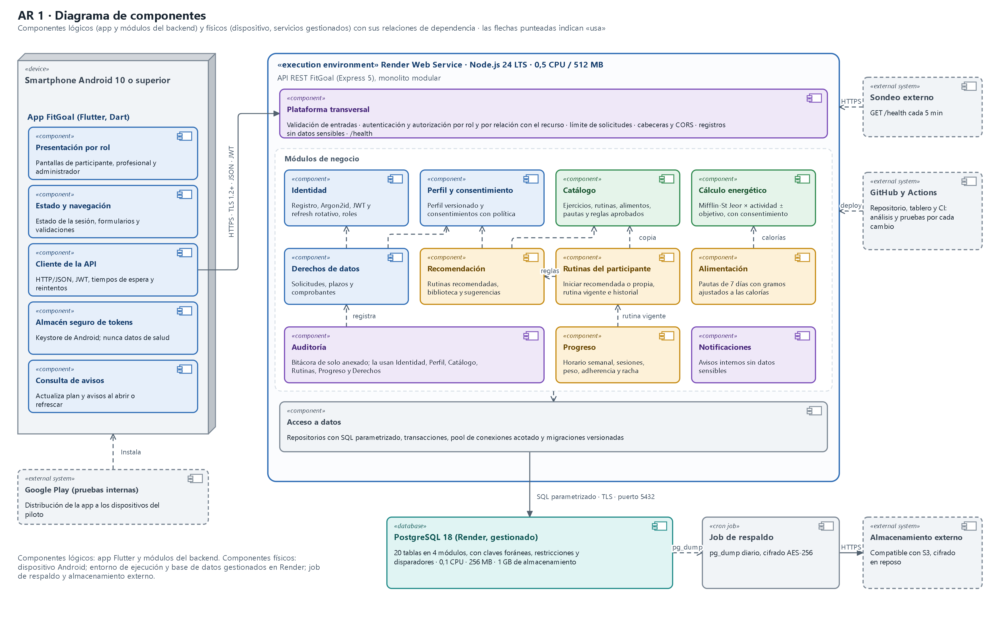

El backend es un monolito modular: cada módulo es un componente lógico con responsabilidades y dependencias explícitas, y todos acceden a los datos mediante la capa de acceso a datos. Se eligió un solo despliegue porque tres estudiantes pueden operarlo; los límites entre módulos y los contratos internos permiten separarlos en el futuro si fuera necesario.

| Componente | Tipo | Responsabilidad | Depende de | Rutas o puertos |
| --- | --- | --- | --- | --- |
| Presentación por rol | App Flutter | Pantallas de participante, preparador (catálogo), nutricionista y administrador, con navegación por rol. | Estado y navegación; Cliente de la API | — |
| Estado y navegación | App Flutter | Estado de la sesión, formularios y validaciones de interfaz (prevención de errores y mensajes de estado). | Cliente de la API | — |
| Cliente de la API | App Flutter | HTTP/JSON con JWT, tiempos de espera de 10 s y renovación única de la sesión ante un 401. | Almacén seguro de tokens; API REST | Todas las rutas |
| Almacén seguro de tokens | App Flutter | Guarda JWT y refresh token en el almacenamiento seguro del sistema operativo (Keystore). | — | — |
| Consulta de avisos | App Flutter | Actualiza la rutina y los avisos al abrir o refrescar la app. | Cliente de la API | GET /notifications/me, GET /plans/me |
| Plataforma transversal | API REST | Validación de entradas, autenticación y autorización por rol, límite de solicitudes, cabeceras y CORS, registros sin datos sensibles y /health. | Identidad; Acceso a datos | GET /health |
| Identidad | API REST | Registro, inicio y cierre de sesión, Argon2id, JWT de 15 minutos, refresh token rotativo, roles y cuentas. | Auditoría; Acceso a datos | POST /auth/register, /auth/login, /auth/refresh, /auth/logout, /auth/change-password; GET, POST y PATCH /admin/users |
| Perfil y consentimiento | API REST | Perfil versionado y validado, con estatura y peso (IMC) bajo consentimiento específico, y consentimientos con versión de la política. | Auditoría; Acceso a datos | GET y PUT /profiles/me; GET y POST /consents |
| Catálogo | API REST | Ejercicios, rutinas y reglas de recomendación con versión y aprobación del profesional competente; retiro de contenido. | Auditoría; Acceso a datos | /catalog/exercises, /catalog/templates, /catalog/rules (con /approve y /retire) |
| Cálculo energético | API REST | Mifflin-St Jeor × factor de actividad, ajustado por objetivo con las reglas nutricionales aprobadas; exige consentimientos. | Perfil y consentimiento; Catálogo (reglas) | GET /estimates/energy |
| Alimentación | API REST | Pautas de 7 días aprobadas, con los gramos ajustados a las calorías del objetivo; cambio de un alimento por un equivalente aprobado del mismo grupo; catálogo nutricional de la nutricionista (alimentos y pautas). | Cálculo energético; Perfil y consentimiento; Auditoría | GET /meal-plans, GET /meal-plans/{id}, GET /meal-plans/{id}/alternatives, PUT y DELETE /meal-plans/{id}/swaps; /catalog/foods, /catalog/meal-plans (con /approve y /retire) |
| Recomendación | API REST | Cálculo del IMC, reglas de seguridad, elección de la división de la semana, rutinas recomendadas según las reglas aprobadas, exploración del catálogo, biblioteca de ejercicios y sugerencias según el objetivo. | Perfil y consentimiento; Catálogo | GET /routines, GET /routines/{id}, GET /exercises, GET /exercises/suggestions |
| Rutinas del participante | API REST | Iniciar una rutina recomendada o propia, validar y copiar su contenido, programar sesiones, rutina vigente e historial. | Recomendación; Perfil y consentimiento; Catálogo; Auditoría | POST /plans/start; GET /plans/me; GET /plans/me/history |
| Progreso | API REST | Horario semanal con días de descanso, sesiones programadas y realizadas, peso con consentimiento, adherencia, racha con comodín semanal y calendario. | Rutinas del participante (rutina vigente); Perfil y consentimiento; Notificaciones | GET /schedule/me; GET /sessions/me; POST /sessions/{id}/complete; GET y POST /weights/me; GET /progress/me |
| Notificaciones | API REST | Avisos internos sin información sensible y recordatorios de sesiones. | Acceso a datos | GET /notifications/me; POST /notifications/{id}/read |
| Derechos de datos | API REST | Solicitudes del titular, comprobantes, plazos y ejecución por tipo de derecho. | Perfil y consentimiento; Identidad; Auditoría | GET y POST /data-requests; GET /admin/data-requests; POST /admin/data-requests/{id}/resolve |
| Auditoría | API REST | Bitácora de solo anexado con autor, fecha, entidad y versión. | Acceso a datos | GET /admin/audit |
| Acceso a datos | API REST | Repositorios con SQL parametrizado, transacciones, pool acotado y migraciones versionadas. | PostgreSQL | — |
| PostgreSQL 18 | Base de datos (Render) | 20 tablas con claves foráneas, restricciones y disparadores. | — | Puerto 5432, TLS |
| Job de respaldo | Cron job (Render) | Exportación diaria con pg_dump y cifrado AES-256 hacia el almacenamiento externo. | PostgreSQL; Almacenamiento externo | — |
| Sondeo externo | Servicio externo | Consulta /health cada 5 minutos para medir la disponibilidad. | API REST | GET /health |

## 5. Modelo de datos

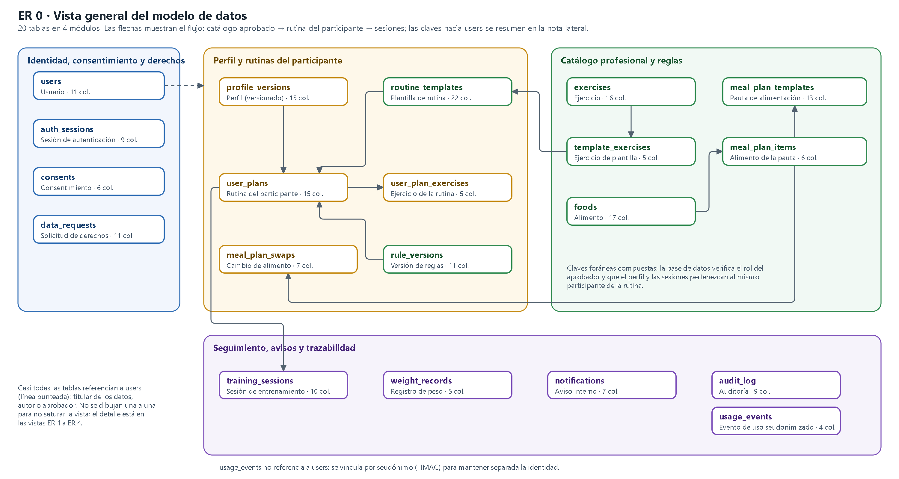

El modelo relacional tiene 20 tablas en cuatro módulos y se implementa en PostgreSQL 18, elegido por las relaciones entre usuarios, perfiles, catálogo aprobado y rutinas, y por la necesidad de integridad referencial y transacciones. La base de datos aplica por sí misma las reglas que el informe declara como requisitos: solo el preparador aprueba ejercicios, rutinas y reglas de entrenamiento y solo la nutricionista los alimentos, las pautas de alimentación y las reglas nutricionales, una rutina solo puede iniciarse desde una plantilla aprobada y solo con ejercicios aprobados, una pauta solo se aprueba con alimentos aprobados, un alimento de la pauta solo se cambia por otro aprobado del mismo grupo que esa pauta incluye, una rutina iniciada y una pauta aprobada no se modifican, la bitácora es de solo anexado, el sexo y la actividad del cálculo de calorías exigen la estatura y el peso, y hay una única rutina vigente por participante.

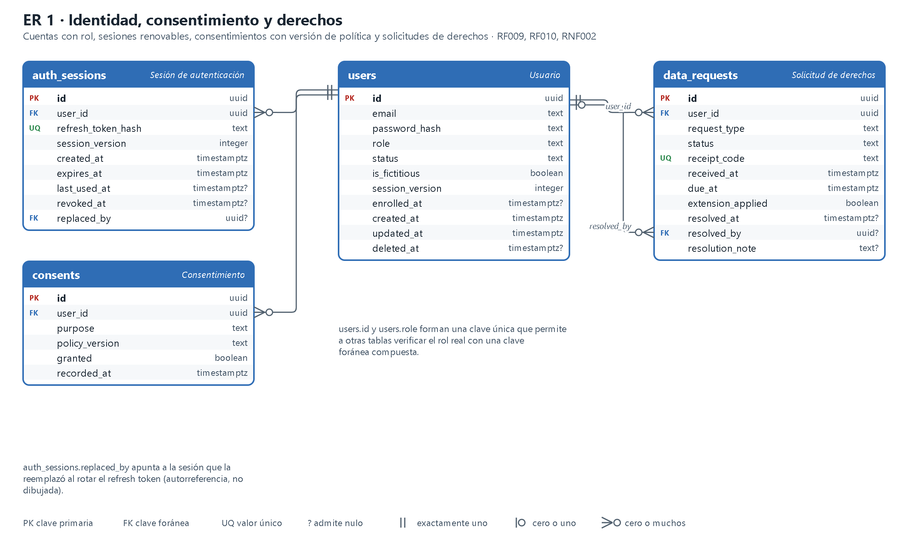

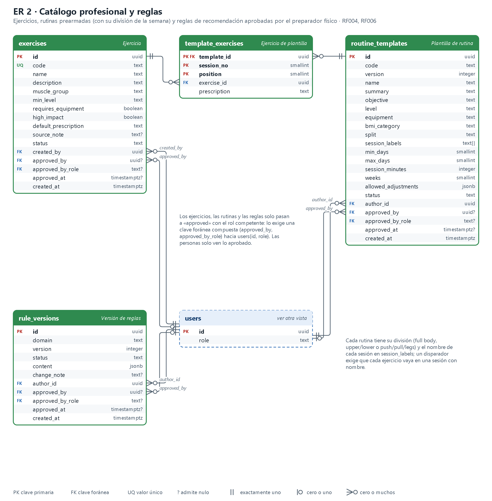

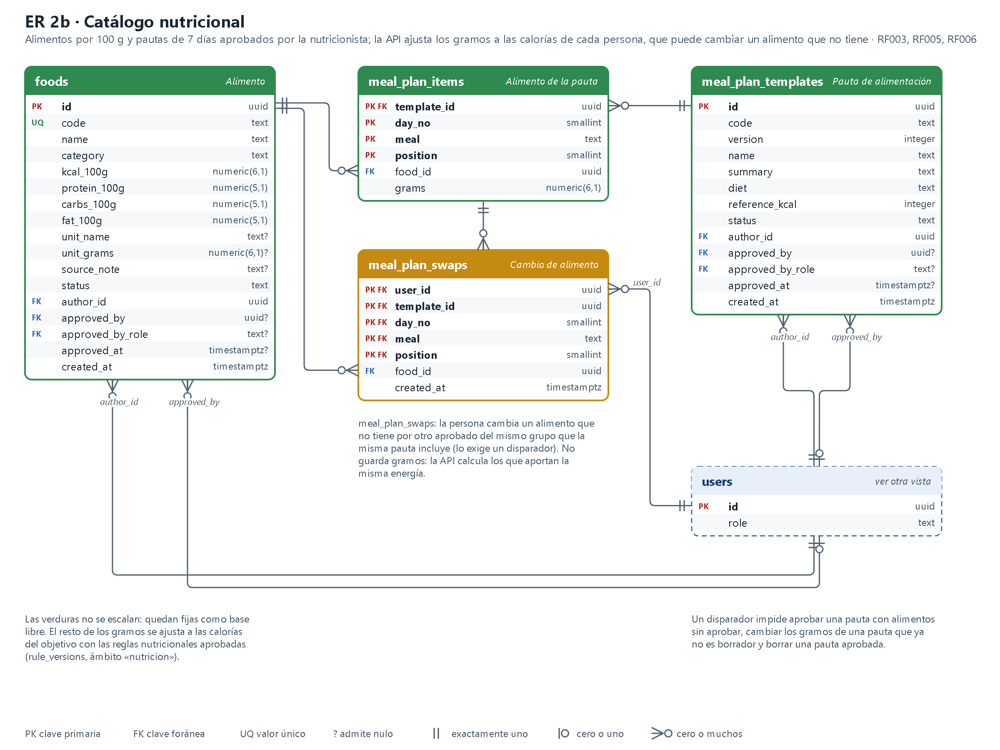

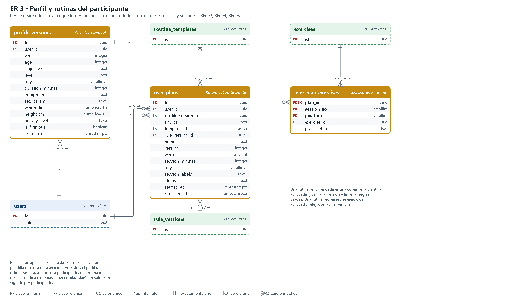

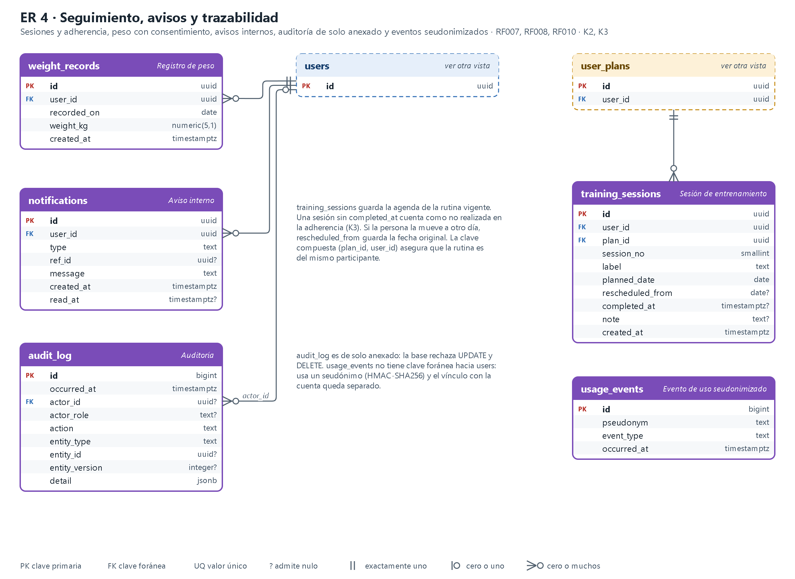

### Correspondencia con las entidades del informe

| Entidad del informe | Tabla | Observación |
| --- | --- | --- |
| Usuario | users | Cuenta con rol: participante, preparador físico, nutricionista o administrador. |
| Perfil | profile_versions | Cada cambio crea una versión; la rutina del participante referencia la versión usada. |
| Objetivo | profile_versions.objective | Bajar, mantener o subir de peso, dentro del perfil versionado. |
| Plantilla (rutina recomendada) | routine_templates, template_exercises, exercises | Rutina prearmada, definida y aprobada una sola vez por el preparador; los ejercicios se componen desde el catálogo aprobado. |
| Versión de reglas | rule_versions | En entrenamiento: matriz de recomendación (objetivo, nivel, equipo, categoría de IMC y división), regla de división, reglas de seguridad y grupos sugeridos. En nutrición: factores de actividad, déficit y superávit por objetivo, tope del déficit, mínimo por sexo y ajustes por IMC. Siempre con aprobación. |
| Minuta (pauta de alimentación) | meal_plan_templates, meal_plan_items, foods, meal_plan_swaps | Pauta de 7 días por tipo de dieta, aprobada una sola vez por la nutricionista con alimentos aprobados; la API ajusta los gramos a las calorías de cada persona, que puede cambiar un alimento que no tiene por otro aprobado del mismo grupo de esa pauta. |
| Rutina del participante (plan vigente) | user_plans, user_plan_exercises | Copia inmutable de una rutina aprobada, o rutina propia con ejercicios aprobados; una sola vigente por persona. |
| Aprobación profesional | exercises, routine_templates, foods, meal_plan_templates, rule_versions (status, approved_by, approved_by_role) | La base exige que quien aprueba tenga el rol competente; solo lo aprobado se ofrece a las personas. |
| Sesión | training_sessions (entrenamiento), auth_sessions (acceso) | Sesión programada y declarada; la sesión de autenticación se guarda aparte. |
| Consentimiento | consents | Registro anexado con la versión de la política. |
| Auditoría | audit_log | Bitácora de solo anexado. |

### Relaciones

| Tabla hija | Columnas | Tabla padre | Columnas | Cardinalidad |
| --- | --- | --- | --- | --- |
| auth_sessions | user_id | users | id | 1 : 0..N |
| consents | user_id | users | id | 1 : 0..N |
| data_requests | user_id | users | id | 1 : 0..N |
| data_requests | resolved_by | users | id | 0..1 : 0..N |
| exercises | created_by | users | id | 1 : 0..N |
| exercises | approved_by, approved_by_role | users | id, role | 0..1 : 0..N |
| rule_versions | author_id | users | id | 1 : 0..N |
| rule_versions | approved_by, approved_by_role | users | id, role | 0..1 : 0..N |
| routine_templates | author_id | users | id | 1 : 0..N |
| routine_templates | approved_by, approved_by_role | users | id, role | 0..1 : 0..N |
| template_exercises | template_id | routine_templates | id | 1 : 0..N |
| template_exercises | exercise_id | exercises | id | 1 : 0..N |
| foods | author_id | users | id | 1 : 0..N |
| foods | approved_by, approved_by_role | users | id, role | 0..1 : 0..N |
| meal_plan_templates | author_id | users | id | 1 : 0..N |
| meal_plan_templates | approved_by, approved_by_role | users | id, role | 0..1 : 0..N |
| meal_plan_items | template_id | meal_plan_templates | id | 1 : 0..N |
| meal_plan_items | food_id | foods | id | 1 : 0..N |
| profile_versions | user_id | users | id | 1 : 0..N |
| user_plans | user_id | users | id | 1 : 0..N |
| user_plans | template_id | routine_templates | id | 0..1 : 0..N |
| user_plans | rule_version_id | rule_versions | id | 0..1 : 0..N |
| user_plans | profile_version_id, user_id | profile_versions | id, user_id | 1 : 0..N |
| user_plan_exercises | plan_id | user_plans | id | 1 : 0..N |
| user_plan_exercises | exercise_id | exercises | id | 1 : 0..N |
| meal_plan_swaps | user_id | users | id | 1 : 0..N |
| meal_plan_swaps | food_id | foods | id | 1 : 0..N |
| meal_plan_swaps | template_id, day_no, meal, position | meal_plan_items | template_id, day_no, meal, position | 1 : 0..N |
| training_sessions | plan_id, user_id | user_plans | id, user_id | 1 : 0..N |
| weight_records | user_id | users | id | 1 : 0..N |
| notifications | user_id | users | id | 1 : 0..N |
| audit_log | actor_id | users | id | 0..1 : 0..N |

### Disparadores y funciones

| Nombre | Tabla | Finalidad |
| --- | --- | --- |
| audit_log_append_only | audit_log | Impide modificar o borrar filas de la bitácora. |
| user_plans_integrity | user_plans | Una rutina recomendada solo puede copiarse de una plantilla aprobada, y una rutina ya iniciada conserva su contenido (solo cambian el estado y la fecha de reemplazo). |
| user_plan_exercises_integrity | user_plan_exercises | Solo se pueden agregar ejercicios aprobados a una rutina, y la composición de una rutina iniciada no se modifica. |
| template_exercises_frozen | template_exercises | Impide cambiar los ejercicios de una plantilla que ya no es borrador (se crea una versión nueva) y exige que cada ejercicio vaya en una sesión con nombre. |
| meal_plan_items_frozen | meal_plan_items | Impide cambiar los alimentos de una pauta que ya no es borrador (se crea una versión nueva), exige alimentos aprobados al aprobarla e impide borrar una pauta aprobada. |
| meal_plan_swaps_valid | meal_plan_swaps | Un alimento solo se cambia en una pauta aprobada y por otro distinto, aprobado, del mismo grupo y que la nutricionista incluyó en esa misma pauta. |

### Verificación del modelo

El script `docs/diagramas/schema/validate.mjs` aplica la migración en un PostgreSQL real (PGlite 0.5.8, que ejecuta PostgreSQL 18.3) y ejecuta 79 comprobaciones de integridad: contraseña con Argon2id, correo único sin distinguir mayúsculas, perfil adulto, días válidos, estatura y peso juntos y en rangos humanos, sexo y actividad solo con estatura y peso, competencia del aprobador de ejercicios, rutinas, alimentos, pautas y reglas, plantillas aprobadas inmutables, división válida y sesiones con nombre, solo plantillas y ejercicios aprobados en una rutina, rutina iniciada inmutable (con los nombres de sus sesiones), una sola rutina vigente, sesión movida con su fecha original distinta de la nueva, composición plausible de los alimentos, pautas solo con alimentos aprobados e inmutables una vez aprobadas, cambios de alimento solo por otro aprobado del mismo grupo que la pauta incluye, bitácora de solo anexado y formato del seudónimo.

El diccionario de datos completo, con cada columna, tipo, restricción y descripción, está en `docs/diccionario_de_datos.md`.

## 6. Comportamiento

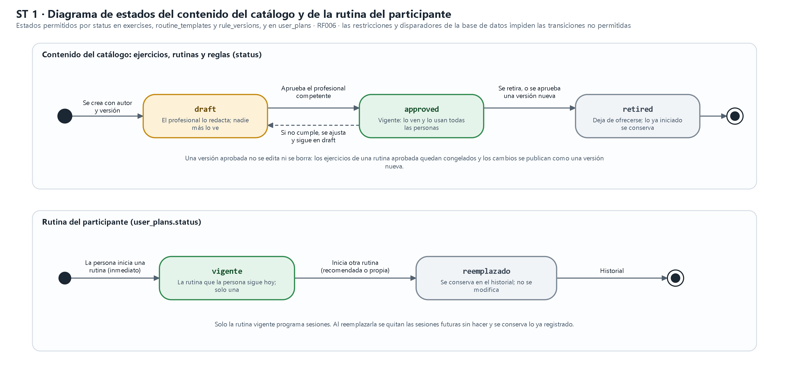

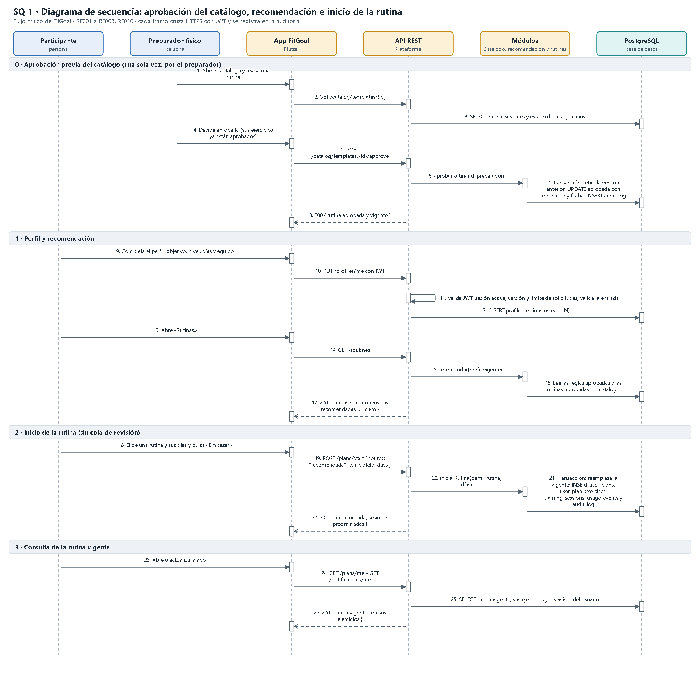

El diagrama de estados define dos ciclos de vida. El contenido del catálogo (ejercicios, rutinas y reglas) nace «draft», pasa a «approved» cuando lo aprueba el profesional competente y termina «retired» cuando se retira o se aprueba una versión nueva. La rutina del participante solo está «vigente» o «reemplazada». La secuencia muestra el flujo crítico completo: la aprobación previa del catálogo, el perfil y la recomendación, el inicio inmediato de la rutina y su consulta, con las transacciones que garantizan la consistencia entre aprobación, inicio de la rutina y auditoría.

## 7. Topología de comunicaciones

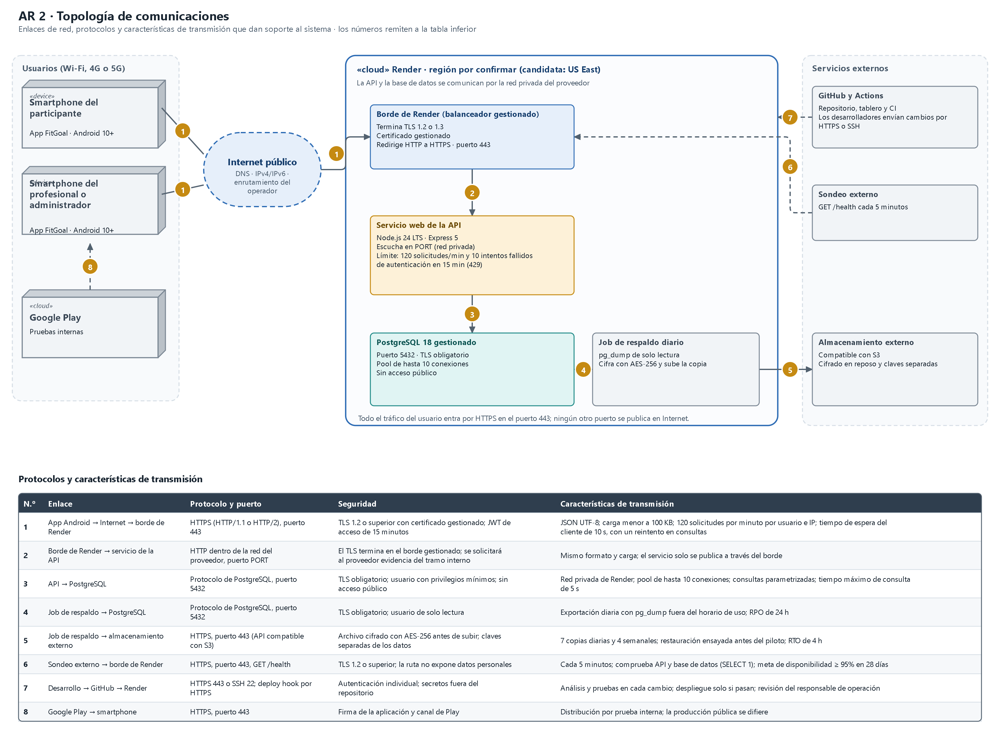

Todo el tráfico del usuario entra por HTTPS (puerto 443) al borde gestionado de Render, que termina TLS 1.2 o superior; la API y la base de datos se comunican por la red privada del proveedor y la base exige TLS. El tramo entre el borde y el servicio ocurre dentro de la red del proveedor, y se solicitará evidencia de su protección antes del piloto.

| N.º | Enlace | Protocolo y puerto | Seguridad | Características de transmisión |
| --- | --- | --- | --- | --- |
| 1 | App Android → Internet → borde de Render | HTTPS (HTTP/1.1 o HTTP/2), puerto 443 | TLS 1.2 o superior con certificado gestionado; JWT de acceso de 15 minutos | JSON UTF-8; carga menor a 100 KB; 120 solicitudes por minuto por usuario e IP; tiempo de espera del cliente de 10 s, con un reintento en consultas |
| 2 | Borde de Render → servicio de la API | HTTP dentro de la red del proveedor, puerto PORT | El TLS termina en el borde gestionado; se solicitará al proveedor evidencia del tramo interno | Mismo formato y carga; el servicio solo se publica a través del borde |
| 3 | API → PostgreSQL | Protocolo de PostgreSQL, puerto 5432 | TLS obligatorio; usuario con privilegios mínimos; sin acceso público | Red privada de Render; pool de hasta 10 conexiones; consultas parametrizadas; tiempo máximo de consulta de 5 s |
| 4 | Job de respaldo → PostgreSQL | Protocolo de PostgreSQL, puerto 5432 | TLS obligatorio; usuario de solo lectura | Exportación diaria con pg_dump fuera del horario de uso; RPO de 24 h |
| 5 | Job de respaldo → almacenamiento externo | HTTPS, puerto 443 (API compatible con S3) | Archivo cifrado con AES-256 antes de subir; claves separadas de los datos | 7 copias diarias y 4 semanales; restauración ensayada antes del piloto; RTO de 4 h |
| 6 | Sondeo externo → borde de Render | HTTPS, puerto 443, GET /health | TLS 1.2 o superior; la ruta no expone datos personales | Cada 5 minutos; comprueba API y base de datos (SELECT 1); meta de disponibilidad ≥ 95% en 28 días |
| 7 | Desarrollo → GitHub → Render | HTTPS 443 o SSH 22; deploy hook por HTTPS | Autenticación individual; secretos fuera del repositorio | Análisis y pruebas en cada cambio; despliegue solo si pasan; revisión del responsable de operación |
| 8 | Google Play → smartphone | HTTPS, puerto 443 | Firma de la aplicación y canal de Play | Distribución por prueba interna; la producción pública se difiere |

## 8. Infraestructura

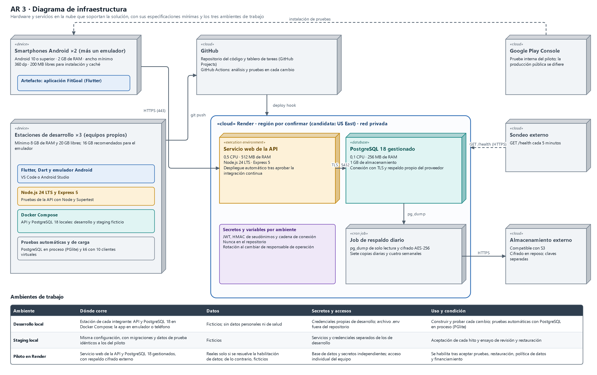

| Ambiente | Dónde corre | Datos | Secretos y accesos | Uso y condición |
| --- | --- | --- | --- | --- |
| Desarrollo local | Estación de cada integrante: API y PostgreSQL 18 en Docker Compose; la app en emulador o teléfono | Ficticios; sin datos personales ni de salud | Credenciales propias de desarrollo; archivo .env fuera del repositorio | Construir y probar cada cambio; pruebas automáticas con PostgreSQL en proceso (PGlite) |
| Staging local | Misma configuración, con migraciones y datos de prueba idénticos a los del piloto | Ficticios | Servicios y credenciales separados de los de desarrollo | Aceptación de cada hito y ensayo de revisión y restauración |
| Piloto en Render | Servicio web de la API y PostgreSQL 18 gestionados, con respaldo cifrado externo | Reales solo si se resuelve la habilitación de datos; de lo contrario, ficticios | Base de datos y secretos independientes; acceso individual del equipo | Se habilita tras aceptar pruebas, restauración, política de datos y financiamiento |

Las cifras de CPU, memoria y almacenamiento corresponden a las tarifas públicas consultadas el 1 de octubre de 2026 y a las condiciones del presupuesto del informe; deben confirmarse al contratar. La región se definirá al abrir la cuenta, considerando la latencia desde Chile.

## 9. Arquitectura de la solución

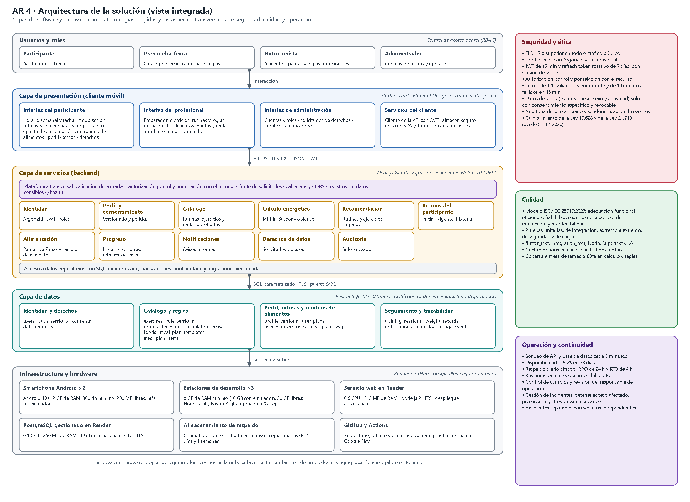

La vista integrada une las capas de software (presentación, servicios y datos) con el hardware y los servicios que las soportan, y muestra los aspectos transversales de seguridad y ética, calidad y operación que atraviesan todas las capas.

## 10. Matriz de trazabilidad

| Requerimiento | Nombre | Casos de uso | Módulos | Tablas | Proceso BPMN | KPI | Prueba |
| --- | --- | --- | --- | --- | --- | --- | --- |
| RF001 | Registro y perfil | CU-01, CU-03, CU-17 | Identidad; Perfil y consentimiento | users, auth_sessions, consents, profile_versions | P1 (SP1.1, SP1.2) | K1 | P01 |
| RF002 | Objetivo y disponibilidad | CU-03, CU-17 | Perfil y consentimiento | profile_versions | P1 (SP1.2) | K1, K5 | P02 |
| RF003 | Estimación de calorías | CU-15, CU-25 | Cálculo energético; Catálogo | profile_versions, consents, rule_versions | P1 | K6 | P03 |
| RF004 | Rutinas recomendadas y propias | CU-04 a CU-09, CU-18, CU-19, CU-21, CU-22 | Catálogo; Recomendación; Rutinas del participante | routine_templates, template_exercises, exercises, rule_versions, user_plans, user_plan_exercises | P1 (SP1.3), P2 (SP2.1, SP2.2) | K5, K6, K9 | P04 |
| RF005 | Pauta de alimentación de 7 días | CU-16, CU-25 | Alimentación; Cálculo energético; Catálogo | foods, meal_plan_templates, meal_plan_items, meal_plan_swaps, rule_versions | P5 | K5, K6 | P05 |
| RF006 | Aprobación profesional del catálogo | CU-21 a CU-24 | Catálogo | exercises, routine_templates, rule_versions | P5 (SP5.1, SP5.2) | K5 | P06 |
| RF007 | Progreso y sesiones | CU-10, CU-11, CU-12, CU-29 | Progreso | training_sessions, weight_records, usage_events | P3 (SP3.1, SP3.2) | K2, K3, K4 | P07 |
| RF008 | Aviso interno | CU-13 | Notificaciones | notifications | P3 | K2 | P08 |
| RF009 | Control de datos | CU-01, CU-14, CU-20, CU-27 | Derechos de datos; Perfil y consentimiento | consents, data_requests | P4 (SP4.1) | K1, K5 | P09 |
| RF010 | Roles y auditoría | CU-02, CU-26, CU-28 | Identidad; Auditoría | users, audit_log | P5 | K5 | P10 |
| RNF001 | Usabilidad | CU-01, CU-03 | Presentación por rol | usage_events | P1 | K1, K4 | P11 |
| RNF002 | Seguridad y datos | CU-02, CU-20 | Plataforma; Identidad; Auditoría | users, auth_sessions, consents, audit_log | P1 (SP1.1), P4 | K5 | P12 |
| RNF003 | Disponibilidad y recuperación | CU-30, CU-31 | Job de respaldo; Sondeo externo | — | — | K7 | P13 |
| RNF004 | Rendimiento | CU-04, CU-06 | Recomendación; Plataforma | routine_templates, rule_versions | P1 (SP1.3), P2 | K6 | P14 |

La columna «Prueba» remite a las evidencias propuestas en el Anexo 2 del informe. Esta matriz extiende la trazabilidad del informe (requisito → KPI → prueba) hacia el diseño: requisito → caso de uso → módulo → tabla → proceso.
